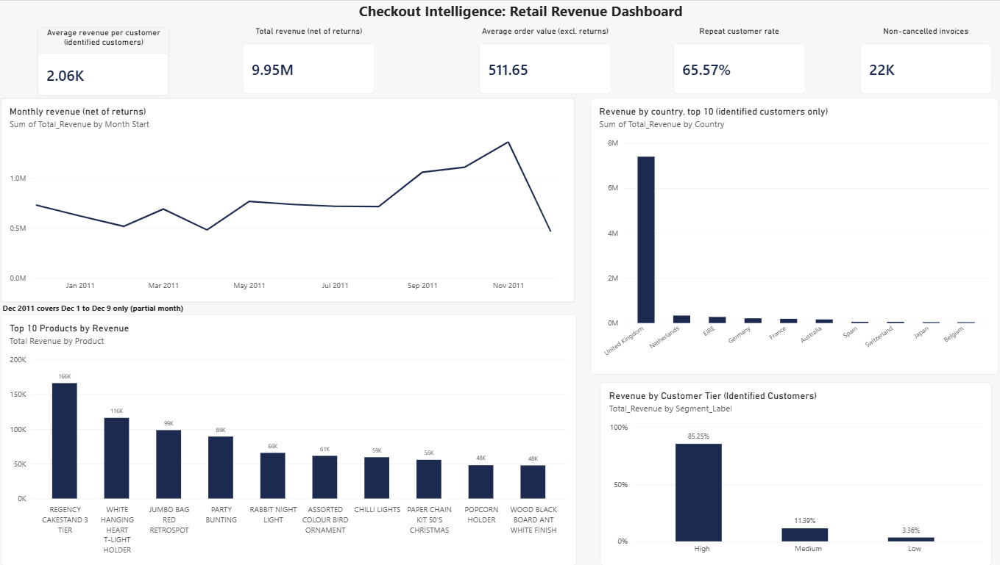
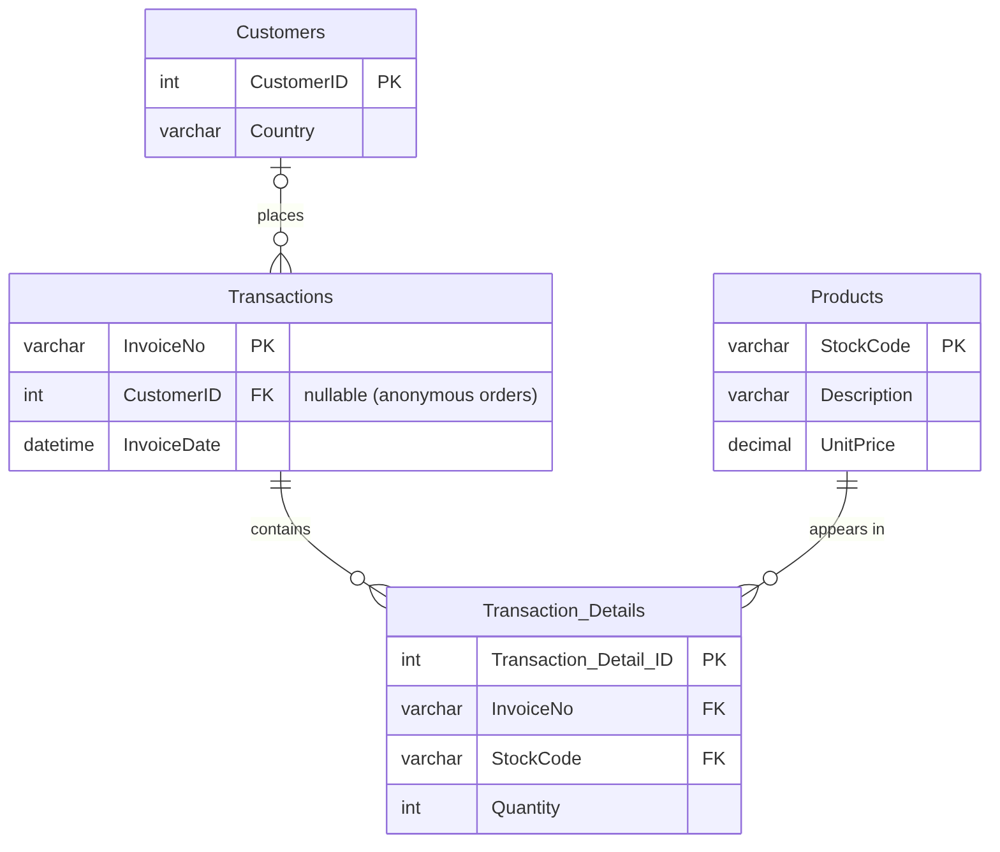

# Checkout Intelligence: A BI Case Study on Retail Operations

An end-to-end business intelligence project on a year of retail transactions: a normalized SQL Server database with a verified KPI layer, a Python exploratory analysis, and a Power BI dashboard. The project is descriptive and diagnostic. It answers *what happened* and *why it might have happened*, and it is explicit about what the data cannot show.

Inspired by product analytics work on self-checkout operations.



## The business problem

A retailer has a year of transaction records but no trusted view of where revenue comes from, which customers and days matter most, or which patterns are real and which are data errors. The goal was to produce one set of verified KPIs, answer six concrete business questions, and document the limits of every finding.

## Data

[Online Retail dataset](https://archive.ics.uci.edu/dataset/352/online+retail) (UCI Machine Learning Repository): roughly 542,000 line items from a UK-based online retailer, December 1, 2010 to December 9, 2011. Many customers are wholesale buyers, and about 25% of rows have no customer ID.

Citation: Chen, D. (2015). *Online Retail* [Dataset]. UCI Machine Learning Repository. https://doi.org/10.24432/C5BW33. Licensed under [CC BY 4.0](https://creativecommons.org/licenses/by/4.0/).

## Approach

| Phase | What I did | Tools |
|---|---|---|
| 1. Data model | Designed a 4-table model: Customers, Products, Transactions, Transaction_Details | SQL Server |
| 2. KPI layer | Loaded and cleaned the data, then built 12 SQL views for revenue, orders, customers, and segments | SQL Server, SSMS |
| 3. Exploration | Checked distributions, missing values, and anomalies; built features (day of week, first vs repeat purchase, high-value flag); answered order-level questions | Python, pandas, Jupyter |
| 4. Dashboard | Connected Power BI to the SQL views and built a one-page dashboard | Power BI |

## Data model

Four normalized tables. A transaction's customer is optional, because about 25% of orders are anonymous and are kept as legitimate revenue.



## Key findings

All monetary values are in pounds sterling (£), the currency of the source data. Each figure below states its basis: net or gross of returns.

**Revenue and orders (SQL, net of returns)**
- Total revenue: **£9,954,901.66**.
- 22,064 non-cancelled invoices; average order value **£511.65** (excludes cancelled orders).
- **65.57%** of identified customers placed more than one order. This is high because the customer base is wholesale-heavy.
- Revenue peaks in **November 2011** (holiday season). December 2011 is a partial month because the data ends on December 9.

**Customers (SQL, identified customers only)**
- The top third of customers produce **85.25%** of identified-customer revenue; the middle third 11.39%; the bottom third 3.36%.
- In Python (gross revenue), the top 20% of customers produce 75.7% of identified-customer revenue.

**Why does Thursday lead? (Python, gross revenue, order level)**

Thursday leads on **volume, not order size**.

| Day | Orders | Average order | Median order |
|---|---|---|---|
| Thursday | 4,370 | £531.68 | £300.15 |
| Wednesday | 3,843 | £486.96 | £301.30 |
| Tuesday | 3,674 | £568.30 | £307.17 |
| Friday | 3,261 | £532.93 | £299.42 |
| Monday | 3,187 | £519.70 | £304.28 |
| Sunday | 2,206 | £377.50 | £270.05 |

The business records no sales on Saturdays.

**Do repeat customers place bigger orders? (Python, gross revenue)**

| Purchase type | Orders | Average order | Median order |
|---|---|---|---|
| Repeat | 14,056 | £539.22 | £309.84 |
| First | 4,349 | £450.75 | £302.40 |
| Unknown (no customer ID) | 2,136 | £454.17 | £71.40 |

The average is about 20% higher for repeat customers, but the medians are nearly equal, so a few very large orders drive the gap. Anonymous orders have a much lower median.

## Data quality: problems found and fixed

Each fix was checked by reconciling totals before and after.

| Problem | How I found it | Fix | Impact |
|---|---|---|---|
| 10 non-product admin codes (postage, bank charges, discounts, samples) mixed into the product data, 2,912 rows | Unusual stock codes with no real product description | Built `vw_RealProducts` and joined every KPI view through it | -£315,932.02 |
| 1,336 rows with negative quantity, no cancellation prefix, and no customer ID | Python EDA found large negative quantities outside cancelled invoices; spread across all months and 100+ products | Excluded as likely inventory adjustments, not customer sales | -£386,873.19 |
| Revenue views dropped cancelled invoices | A top-10 products chart ranked a cancelled order (invoice 581483, 80,995 units, reversed by C581484 twelve minutes later) as the second-best product | Removed the cancelled-invoice filter from five revenue views so they count returns as negative revenue (`SQL/08_net_revenue_view_fix.sql`) | Every revenue chart now reconciles to the net total |
| One malformed invoice number from a CSV parsing artifact | Reconciling Python to SQL left £33.20 unexplained | Excluded in most views; documented | £33.20 |

**Reconciling Python to SQL.** Python revenue is gross (£10,509,712.05) because its data holds no cancelled invoices. SQL revenue is net (£9,954,901.66). The 3,422 cancelled invoices (-£554,843.59) plus the £33.20 malformed row explain the full difference.

**Row reconciliation: raw data to the cleaned export used in Python.**

| Step | Rows |
|---|---|
| Raw file (matches the database's order-lines table) | 541,909 |
| Remove the 10 admin codes | -2,912 |
| Remove lines on cancelled invoices (real products) | -8,704 |
| Remove 1 line with a malformed invoice number | -1 |
| Cleaned export used in Python | **530,292** |

The 1,336 inventory-adjustment rows are still in the export and are removed inside the notebook.

## Limitations

- **Static dashboard.** Each chart reads a separate SQL view, so charts do not filter each other. Interactivity would need a relational model in Power BI with DAX measures.
- **One year of data.** Seasonality and year-over-year change cannot be measured.
- **Line items are not orders.** The Python high-value flag describes single product lines, not whole orders.
- **Anonymous transactions.** About 25% of rows have no customer ID. They count in revenue totals but are excluded from customer-level metrics.
- **Small basis differences between cards.** The order count (22,064) includes 1,523 invoices with no real-product lines, while the average order value uses 20,541 invoices. Average revenue per customer uses 4,363 customers, while the repeat rate uses 4,339.
- **Exclusion decisions are judgment calls.** The inventory-adjustment explanation is the most likely one, not a confirmed one.
- **No causal claims.** Statements such as "target Thursday staffing" are hypotheses to test, not conclusions.

## Repository structure

```
SQL/                 Numbered scripts: database build, import, KPI views, data fixes
Python/              01_EDA_Exploration.ipynb
Data/Raw Data/       Original Online Retail files
Data/Clean Data/     Cleaned exports used by the notebook
Power BI/            Checkout Intelligence Dashboard.pbix
Images/              Dashboard screenshot
```

## How to reproduce

1. Use the raw data in `Data/Raw Data/` (the original download is linked above) and run the scripts in `SQL/` in order in SQL Server Management Studio. Edit the file path in script 02 to point to the CSV on your machine.
2. Open `Python/01_EDA_Exploration.ipynb` in Jupyter and run all cells.
3. Open the `.pbix` in Power BI Desktop and update the SQL Server name in the data source settings.

## Possible next steps

- Build a relational Power BI model with DAX measures so slicers filter every chart.
- Add customer segmentation by recency, frequency, and spend (RFM).
- Add a second module on self-checkout fraud, using the [Fraud Detection in Grocery Shopping Transactions](https://www.kaggle.com/datasets/oscarm524/fraud-detection-in-grocery-shopping-transactions) dataset (from the [Data Mining Cup 2019](https://www.data-mining-cup.com/reviews/dmc-2019/)). Its license is listed as unknown, so the data is not included in this repository.

## Tools

SQL Server, SSMS, Python (pandas), Jupyter, Power BI, Git and GitHub.
